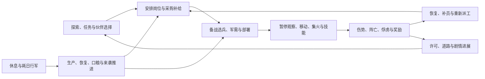

# 《DEMO》游戏拆解案

## 从安顿乡亲到重返白桦村：角色冒险、人员经营与小队战斗的联动

**研究日期：2026 年 11 月 22 日｜实现基线：Unity `9d51480`｜引擎：6000.6.4f1｜文档性质：作品分析，非规则源**

本文拆解当前 Unity Demo，重点不是罗列做了多少系统，而是回答：玩家为什么要经营营地，经营怎样改变下一场战斗，战斗结果又怎样回到人物与村庄的处境中。分析沿着“设计目标—规则—玩家选择—结果反馈”展开；制作意图以已有记录为据，机制作用的推导则作为本文分析。

当前实现已包含人员驻地与编队分层、两波来袭的正式备战入口，以及古窟首通的半血撤离与救援收尾。文中历史对战数据均保留原报告版本与条件，不当作 `9d51480` 的重测成绩。网页战役试玩使用独立规则，地图编辑器属于制作工具，二者不与 Unity 本体混写。

**阅读导航：** [产品定位](#overview) · [玩家旅程](#journey) · [核心循环](#loop) · [人员取舍](#personnel) · [战斗](#combat) · [经营与时间](#economy-time) · [跨系统案例](#cases) · [界面反馈](#interface) · [数据与得失](#evidence) · [总结](#conclusion)

---

<a id="overview"></a>

## 一、产品概览：先有需要照顾的人，再有值得经营的营地

| 维度 | 当前 Demo 的构成 |
| --- | --- |
| 基本类型 | 俯视像素 RPG，结合可暂停的小队即时战斗与按游戏日结算的营地经营 |
| 平台与输入 | Windows 键鼠、Android 横屏触控 |
| 玩家身份 | 离开王都、在白桦村定居的前禁卫；袭击后承担安顿乡亲和寻找搭档的责任 |
| 战斗组织 | 至多三名队长，含主角；单场普通兵上限 24 人 |
| 内容边界 | 白桦村序章至返乡调查、重建和长椅结尾；主线后保留经营、副本及周期来袭 |
| 核心决策 | 如何分配同一批人员、物资和游戏日，在作战保障与营地延续之间取舍 |

项目虽然保留“基地征服”的历史目录名，但体验的起点不是扩张版图，而是一个有具体身份的人遭遇失所。古裔袭村，搭档留在西桥断后，主角护送乡亲撤离，被来历异常的王室秘银剑刺伤。灰岩营地给了众人暂时的落脚点，黑鸦寨却封住返乡道路。

这条叙事把三个目标连在一起：**让乡亲活下去，是眼前任务；打通返乡路，是阶段目标；寻找搭档与追查秘银剑，是继续行动的悬念。** 粮田、兵营和军需因此不只是解锁清单，而是把返乡愿望转成行动的必要条件。

三种玩法也承担不同职责。角色探索建立“我为什么做”；营地经营回答“拿什么做、谁留下”；小队战斗检验“准备能否转化为结果”。它们通过人员、伤势、库存和日期共享后果，而不是各自结束后只交换一个胜利标记。

从操作结构看，本作更适合愿意停下来观察队伍、安排人员，再进入战场验证计划的玩家。暂停减轻连续操作压力，但不会代替配置和判断。其核心承诺不是纯动作反应，也不是自动增长的放置收益，而是：**玩家的准备和处置能改变这一仗，以及这一仗之后的生活。**

依据：[重点总案](../策划/DEMO/00_总策划案.md)、[人物与人员管理](../策划/DEMO/01_系统规则/02_人物与人员管理.md)、[运行环境与发布](../策划/DEMO/07_实现与交付/03_运行环境与发布.md)。

<a id="journey"></a>

## 二、玩家旅程：把系统学习嵌入一次失去与重建

| 阶段 | 玩家当下想解决的问题 | 核心行为与新规则 | 留给下一阶段的变化 |
| --- | --- | --- | --- |
| 白桦村清晨与演练 | 完成村里的日常安排，拿到剑 | 调工、装备、选人、暂停与指挥 | 先认识乡亲、搭档和村庄，再学习战斗 |
| 西桥断后与东口撤离 | 护送乡亲离开袭击 | 跟随、出口、追兵战与重伤剧情 | 搭档失踪、秘银剑成为线索，主角失去原有家园 |
| 灰岩营地与灰岩镇 | 争取安身条件和行动支持 | 对话、交易、招募伙伴、拜访领主 | 建立营地与城镇之间的服务联系，得知古窟救援 |
| 沉眠古窟 | 救人、识别古裔与侵蚀威胁 | 调整同行者、部署、半血撤离、解决控制源 | 获得救援证据，决定如何对待迦兰，交差后取得许可 |
| 营地整备与窝点 | 组织第一批普通兵，准备来袭 | 募兵、派工、军需、情报、可选副本 | 第一次把人员规模、产出和作战需求放到一起比较 |
| 巴图首防 | 守住营地，并决定是否继续追击 | 守时／击退目标、撤退代价、出口与战果 | 伤势和消耗延续；巴图生死改变后续对抗条件 |
| 主动攻寨或留营迎击 | 打通返乡道路 | 行军路粮、异地驻军，或利用数日恢复生产 | 击败主力、解除封路，两条行动路线汇向返乡 |
| 白桦村调查与重建 | 找搭档线索，让乡亲重新安顿 | 可选断剑调查、修家与设施、村民回田、长椅入座 | 阶段目标完成，保留下一段故事与持续经营空间 |

这条流程不是按系统目录排课。开局先让玩家完成一个有对象的派工请求，再在演练里学习指挥；失去村庄后，熟悉的劳作变成了生存问题。系统功能相近，情境却发生变化，玩家从“帮村里做事”转向“为一群人的下一步负责”。

主线还允许局部顺序自由。先接受霍恩的委托再救人，是领命复命；先救人再见领主，则由对白承认已经发生的事实。两条路径共享救援结果和许可，不需要复制两套后续关卡。这里的分支价值主要是**承接玩家行为**，而非宣称每个选择都会长成独立剧情树。

节奏上，探索与经营使用不同时间尺度。走访、交谈和领地内转场不必逐步消耗游戏日；休息及有天数的世界行军才推进生产、恢复与来袭。因此玩家可以在理解规则时停留，但不能通过反复休息无代价地积累。首防日期至少为第六天，并给交差后的玩家保留三天准备期，避免探索顺序过晚直接吞掉整备窗口。

以上规则形成一种“可思考的压力”：危机已知，准备时间有限，但压力主要落在是否推进一天，而不是读对白也在倒数。

依据：[流程与关卡目录](../策划/DEMO/02_流程与关卡/目录.md)、[古窟与窝点](../策划/DEMO/02_流程与关卡/04_沉眠古窟与土匪窝点.md)、[任务日历与事件](../策划/DEMO/01_系统规则/11_任务日历与事件.md)。

<a id="loop"></a>

## 三、核心循环：经营准备进入战斗，战斗后果返回经营



循环的连接点不是抽象“战力”，而是有固定编号的人。一名普通兵能种粮、制军需，也能跟随队长出战。出战记录、伤势和驻地决定他之后能否工作；即使无伤获胜，当天的劳动机会仍然已经使用。战后招降的新兵则可能补上下一轮岗位或编队。

| 要素 | 主要来源与用途 | 对玩家选择的作用 |
| --- | --- | --- |
| 普通兵 | 募兵、俘虏；用于生产、作战和商队 | 同时增加战斗能力、劳力与持续口粮负担 |
| 粮食 | 粮田、购买和奖励；支付日粮、路粮与商队携粮 | 将扩军、跨地行动和持续经营接到同一本账上 |
| 原料与军需 | 原料支持建设和工坊；成品为普通兵提供本场攻防 | 让出兵人数和每场战斗都有实际消耗 |
| 钱币 | 任务、战利品、交易及商队；用于募兵、采购等 | 在立刻补兵、购买军需与长期投入之间提供替代选择 |
| 队长装备与兵书 | 交易、副本、支线；改善少数角色能力 | 把长期养成集中在有名字的人，而非逐个装备所有小兵 |
| 游戏日 | 休息与指定行军推进 | 同时带来产出、恢复和敌军接近，不能只取其中收益 |

这里存在三层相扣的循环：单场战斗检验部署与指挥；一个经营日重新配置生产和恢复；主线则用许可、道路和返乡目标赋予这些循环方向。若只看资源表，营地像生产设施集合；放回流程，它实际承担的是“让队伍有能力继续调查”的中间环节。

战利品也并非纯粹的正反馈。扩军可以提高战斗保障，却增加日常消耗；参战与伤势可能减少当日产出；俘虏必须当场处理，不能无限囤积成下一战才兑现的储备。成长的收益与维持成本共同存在，这正是经营需要反复调整的原因。

当前 Demo 的两处生产基地共享物资库存，各自保留岗位和人员归属；新版正式行军还明确区分留守与到达目的地的驻兵。因此它已经涉及“人在哪里”，但不能套用完整版规划，把本作写成各领地物资独立、必须跨地运输的完整物流模拟。

依据：[营地经营与日结](../策划/DEMO/01_系统规则/04_营地经营与日结.md)、[编队部署与军需](../策划/DEMO/01_系统规则/06_编队部署与军需.md)、[世界行军与据点](../策划/DEMO/01_系统规则/10_世界行军与据点.md)。

<a id="personnel"></a>

## 四、核心特色：同一批人员，承担两种不可同时兑现的价值

### 4.1 从“拥有多少兵”转向“这次动用哪些人”

普通兵既是军力，也是劳力，但这不意味着玩家随时能得到两份完整收益。主动出战要求生命至少 30%，工作也有生命与驻地条件；实际参战后，当天禁止生产，治疗、无伤取胜、重新派岗和读档都不会清除记录。守营可让仍有生命的重伤兵参战，代价则延续到之后的恢复。

这使一次出兵至少包含三本账：本场需要多少战力；参战者离开岗位后少产什么；幸存者什么时候能再次工作。军需按实际落位人数全额消耗，进一步让“带更多人”具有可见成本。不过，少带兵只有在能够完成目标时才是策略；不能因为省军需，就推导任意小队或纯队长都能取胜。

制作记录明确指出：若无伤获胜后同日返营仍可满产，劳动成本就可能消失。当天禁工保留了这部分机会成本，又没有把一次参战延长成未来多日的额外惩罚。同日再战不会重复失去多天劳动，但仍按每场支付军需并承担新伤势。

### 4.2 一个可核算的派工案例

以下是**现行规则的简化演算，不是实测存档**：只看灰岩营地一块六岗位粮田，六名满血普通兵，无负责人加成、余数或其他收入，库存足以供粮；其中两人参战，无人替岗。

| 项目 | 六人全部工作 | 两人参战 |
| --- | ---: | ---: |
| 有效士兵工作量 | 6 | 4 |
| 空岗粮田补益 | 0 | 两份半工，合计 1 |
| 基准产粮，每工作量 4 粮 | 24 | 20 |
| 下一日六名士兵普通日粮 | 6 | 6 |
| 扣除该笔日粮后的理论净增 | 18 | 14 |

这里的减产是 4 粮，而非简单用“少两人×4”得到的 8 粮，因为空岗补益承担了部分缓冲。但它最多补两份半工，只作用于粮田，不能代替工坊实有劳力，也不能把出战变成零成本。

当前实现把这项补益作为粮田规则计算，不需要在名册中虚构两名可调配士兵。这既保留“乡亲协助维持生活”的含义，也防止玩家误以为这些补益能直接编队上场。

### 4.3 预设、草案与驻军分开，保护试错空间

新版兵营按 A／B／C 位保存各兵种目标人数、策略和范围；这是编队意向，不是把人永久从岗位上扣走。正式备战建立本场草案，从本地合格人员中匹配，默认优先生命比例较高者，也允许点名调整。进入地图后，只有合法落位者才成为实际参战名单。

因而，玩家可以先比较方案，再决定是否承担后果。取消整套备战不扣库存；开战才锁军需，结算按实际名单扣除。世界行军则必须显式选兵，出发后人员真实转移，不能把兵营里保存过的数量当作随身军队。**预设负责便利，草案负责比较，驻军负责世界状态。**

### 4.4 战损与补员共同限制滚雪球

普通兵的倒地不等于永久阵亡。实战先判生死，幸存敌兵可能成为俘虏；接纳不再另掷一层招降概率，但受容量和剧情条件约束，普通俘虏须当场处理。伤员可恢复，死者不可逆，因此“胜了几场”和“还剩多少能工作的人”不是同一个指标。

现行全军基准 B＝16，无特性的倒地即死概率为：

```text
raw = 0.5 − 1.5 × (B − N) / (B + N)
p = clamp(raw, 0, 1)
```

N 以开战全军普通兵数为起点，减本场我方永久阵亡，加此前已判定倒地存活的敌普通兵。实战还在截断前叠加最后一击所属队长的特性。N 为 8、16、24 时，无特性概率分别为 0%、50%、80%。这些是**倒地后的条件概率**，不是整队必死比例，更不是健康士兵达到人数就被处死。

这条曲线配合随规模变化的募兵价格和日初供应，提供扩军的反向压力；全军而非单兵种口径，又避免用死亡率强迫玩家平均分配兵种。它能解释设计如何抑制囤兵，但不能单靠公式证明长期经济已经稳定。

依据：[制作理念中的人员取舍](../制作理念.md)、[营地经营规则](../策划/DEMO/01_系统规则/04_营地经营与日结.md)、[经营计算实现](../RPGDemo/Assets/Scripts/Base/BaseEconomy.cs)、[生死与兵源公式](../策划/DEMO/05_数值与配置/00_公式与结算顺序.md)。

<a id="combat"></a>

## 五、战斗拆解：把注意力交给少数队长，把后果留给整支队伍

### 5.1 暂停降低操作负担，不取消决策

正式战斗按连续时间推进，移动、前摇、技能和弹道共享战斗时钟。玩家可暂停观察，再给选中的队长下移动、集火、驻守或策略命令。普通兵跟随所属队长，在指挥范围和个人攻击条件内行动；战斗规模增加，主要操作对象仍不超过三名队长。

这种组织方式把“操作多少单位”与“战场上有多少单位”分开。玩家需要判断哪一路接敌、何时用技能、谁保护射手，而不必逐兵操作所有普通兵。进攻和防守策略又允许临时交出局部控制，把注意力转移到更紧急的小队。

但暂停本身不会带来优势。错误的集火可能使射手离开掩护，骑兵也可能在狭口拥堵。指挥的价值必须通过更早接敌、更好的输出位置或更少的伤损体现，不能只用“发出了更多命令”衡量。

### 5.2 四职业不是四种皮肤，也尚不是完成的石剪布

| 职业 | 主要战术手段 | 约束与适用条件 |
| --- | --- | --- |
| 剑士 | 近身接敌、驻守；普通剑士可锁住正在交战的一名普通敌兵 | 锁定阻止新起步，不是缴械；对方仍能反击，队长不受这项普通兵锁定 |
| 弓兵 | 较长射程，在前排掩护下集中输出 | 被近战压制、攻击移动骑兵会出现相应劣势；视线、队形与掩护影响有效输出 |
| 骑兵 | 较快移动、两细格攻击距离与合法顶开，适合侦察和接近后排 | 通路与地形决定速度能否兑现；被锁时不能主动顶人 |
| 法师 | 不同于物理的减伤计算；普攻对八邻格补充溅射 | 当前普通法师生命和射程较低，攻坚与群伤收益依赖目标防御、密度和施法安全 |

物理攻击按攻防相减形成基础伤害；法术则按防御、攻击方等级和减伤上限计算。两种公式让“高防目标是否值得换法师”成为一个有机制依据的问题。法球溅射以命中时主目标格为中心，八邻格每格最多一敌，各分主击的 1/8；空格份额不转移，墙角和断崖可以阻断，也不会继续连锁。

因此，“能溅射”不等于“稳定翻倍输出”。只有邻格目标足够多、主击有效且法师活着完成施法时，副伤才会兑现。普通法师来自古窟重战后的俘虏招降，并非雷恩的常规募兵项。职业价值还与获取路径有关，不应只看面板攻击。

### 5.3 D10 把不同来源的优势放进一套判定

特性和地形等因素先累计优势、劣势，再相抵。净优势掷两次 D10 取高，净劣势取低，没有净差则单骰。最终 1 必失，10 必中且暴击，其余比较命中与闪避。

用数学示例说明：若同一攻击掷出 4～10 即可命中，单骰为 70%；两骰取高变为 91%，取低变为 49%。这不是新增兵种数值，而是说明优势改变的并非一个固定伤害加值，而是成功分布。自然 10 的出现率也随取高、取低变化。

它的优点是多个系统能使用同一种语言：高低地、远程受贴身压制、骑兵在沼泽出手，都可以表达为判定上的有利或不利；代价是最终效果不总能从面板直观看出，需要战场反馈帮助归因。

### 5.4 地形同时分配信息、接敌与输出机会

视野、射程和高低地掷骰不是同一条加成。全部在场可行动单位提供阵营视野；高处可扩大观察与向低处攻击的距离，整层高差还可能改变远程选骰。墙体与建筑影响射线，坡道决定步行跨层，沼泽影响移动。远程只要看得见、打得到且无遮挡，无须先找到走向目标的道路。

这意味着高台上的弓兵即使没有下坡路，仍可射击；相反，路径可通也不保证站在当前位置能射到。地形价值主要来自何时发现敌人、谁先出手、同时有多少人能攻击，以及撤退是否顺畅，而不是笼统的“站高伤害更大”。

依据：[即时战斗与 AI](../策划/DEMO/01_系统规则/07_即时战斗与AI.md)、[命中与伤害公式](../策划/DEMO/05_数值与配置/00_公式与结算顺序.md)、[法球与伤害实现](../RPGDemo/Assets/Scripts/Battle/RealtimeRpgCombat.cs)、[剑士锁定实现](../RPGDemo/Assets/Scripts/Battle/RealtimeSwordContactPin.cs)。

<a id="economy-time"></a>

## 六、经营、成长与时间：每推进一天，都同时接受收益和威胁

粮食是维持人数的底线，军需是把劳力转成作战能力的消耗品。正式配置中，普通兵不分职业每日各吃 1 粮，队长为零；一级军需加 6 攻、2 防，二级加 10 攻、4 防。它们不是只影响战报的微小修饰，选择哪档、生产多少和带多少人都会改变备战条件。

工坊受实际工作量、配方和原料共同限制。把更多人调去工坊，并不能凭空越过缺料瓶颈；粮田优先、工坊优先和手动策略则提供不同程度的日常托管。资源可以通过采购补齐，给玩家留下“用钱换准备时间”与“用时间换生产”的替代路径。

缺粮的后果也很直接：系统按存档种子、日期和士兵编号生成稳定的分粮顺序，未分到完整份额者离队，留队者正常工作和战斗。它不是用统一攻击减益慢慢拖弱全军，也不按闲置岗位优先清人。这保留了供给失控的风险，避免玩家把排班变成精准淘汰名单。

**首防后的五天窗口**集中展示了时间的双面性。立即攻寨可提前解决威胁、打通道路，但必须带足已恢复的人和路粮；留营能继续生产、训练与补员，却等于选择面对第二波。行军每兵每天另付一份路粮，不能用已经付过日粮来解释为免费远征。情报和日历将威胁转成可规划的日期，而不是完全突袭式的惩罚。

成长则集中在队长。装备、重铸、特性和兵书训练提高少数角色的长期价值，普通兵主要承担职业、规模和伤情管理。这样既保留 RPG 的人物投入，也避免把每个兵都做成复杂养成对象。训练占用经营日与外出资格，提高生命上限也不会自动回满，不能把成长当成战前即时治疗。

副本把练习与收益再分开：体力限制重复胜利后的领奖，不禁止继续入场尝试；首通后的扫荡要求严格高于敌方 1.5 倍参考战力，仍结算军需与伤损。前者允许学习，后者压缩重复操作，但都没有脱离经营账本。

依据：[正式数值配置表](../策划/DEMO/基地征服-系统数值配置表.xlsx)、[交易募兵与重铸](../策划/DEMO/01_系统规则/05_交易募兵与重铸.md)、[技能特性与成长](../策划/DEMO/01_系统规则/08_技能特性与成长.md)、[战果奖励与副本](../策划/DEMO/01_系统规则/09_战果奖励与副本.md)。

<a id="cases"></a>

## 七、三个跨系统案例：机制如何成为剧情的一部分

### 7.1 古窟：人物身份改变解题方法

普通难度下，古窟给非免疫者施加每秒最大生命 3% 的侵蚀，主角和阿铸等特定身份免疫。这不是“骑兵都免疫”，也不是只在对白里说明阿铸特殊；同样一段交战时间，不同人物实际承担的危险不同。玩家可让阿禾留在洞口，换用更适合环境的同行者，也可依靠成长、装备和操作尝试其他解法。

当前首通前，主角受伤降到半血就撤回入口，带队也适用，并把伤害限制在半血线。它为第一次误判提供明确的返回节点，但战损和军需仍按本场处理。独行撤回后，主角会想到镇上的年轻铁匠；这里用受挫后的角色反应提供方向，没有把招募阿铸设成硬性入场钥匙。

交战目标也与救援一致：制伏控制者迦兰即可解除镇民控制，而非要求把两名镇民杀光。胜果锁定后停止交战和侵蚀，清理尚未完成的攻击，镇民恢复为不可攻击的普通人并走向出口；玩家再带队离开。救援因此不是战后奖励框里的一句通知，而是场内状态真的变化。

这一案例把**身份差异、阵容调整、可恢复失败与目标识别**集中在一个小关卡中。首胜只接救援和领主交差，不生成常规副本掉落；迦兰的接纳或处置留到洞外交谈，避免人命选择被普通战利品窗口吞没。

### 7.2 首防：守住之后，仍能改变下一场的敌阵

首防达到 30 秒，或击倒至少一半初始来敌（向上取整），就进入敌方撤离阶段。玩家已经完成守营目标，可以结束追击，也可继续争取击倒巴图。巴图在本战倒地即战死，不按普通俘虏招降处理；逃脱则可能再次出场。

这个分支的价值来自后续确实读取了巴图生死，而不是只换一句战后评价。不过，现行追击阶段已禁止敌方新攻击，也跳过对我方的在飞攻击伤害，不能把它包装成“让伤员冒险以减少未来威胁”。它主要是继续追击争取后续收益，或让敌军撤离、尽快处理战果；分支存在，但风险权衡比交战阶段轻。

首防后，主动攻寨与留营迎击又把战术后果提升为战役安排。前者支付行军与离岗成本，争取主动解除威胁；后者多得恢复与生产时间，但第二波要求全歼，没有首防的守时胜利和普通撤退入口。两条路线都能打通返乡路，不强迫防守获胜的玩家再打一场空寨。

### 7.3 返乡：用熟悉地点表达损失，再由玩家恢复秩序

开局派工发生在麦田，领剑发生在搭档身边，长椅承载两人的日常。返乡复用同一村庄布局，玩家从撤离经过的东口进入，看到的是遭闯入和劫掠后的冷清，而不是另造一张“烧毁村庄”来替代记忆。

断剑与青绳继续搭档线索，但调查可以推后；家、粮田和工坊则在原址修好，三处完成后，乡亲从村口走回麦田。最后不是系统立刻切结算，而是玩家自己走回长椅、坐稳，记录完成日并播放结尾。

这种收尾把开场学过的劳动与空间重新赋义：当初是在日常里帮忙，现在是在恢复日常。它完成“安顿乡亲”的阶段承诺，同时把寻找搭档的悬念留向西方。可选调查不阻塞重建，也让剧情阅读和系统收尾保留不同节奏。

依据：[古窟流程](../策划/DEMO/02_流程与关卡/04_沉眠古窟与土匪窝点.md)与[现行伤害保护实现](../RPGDemo/Assets/Scripts/Base/BaseDemoRuins.cs)、[首防与第二波](../策划/DEMO/02_流程与关卡/05_首防与第二波.md)、[追击阶段攻击处理](../RPGDemo/Assets/Scripts/Battle/RealtimeRpgCombat.cs)、[返乡调查与重建](../策划/DEMO/02_流程与关卡/07_返乡调查与重建.md)。

<a id="interface"></a>

## 八、界面与反馈：让玩家看懂自己正在承担什么

本作的界面重点不是把所有规则同时展开，而是在决定发生处提供比较依据。

| 玩家正在问什么 | 对应信息 | 支撑的判断 |
| --- | --- | --- |
| 这个兵为什么不能工作？ | 固定编号、生命、岗位、参战与疗养状态 | 区分缺人、重伤、外出和当天参战，而非反复改人数 |
| 多带两人会怎样？ | 备战的离岗、日产和结日余粮“现状 → 预计” | 把抽象机会成本变成当场可比较的差额 |
| 是否付得起这次出发？ | 所选军需库存与需求，单列扣前／扣后路粮 | 区分普通日粮、路粮和战斗军需 |
| 敌人何时来？ | 已购军情、可点选日历和行程冲突提示 | 判断训练、休息与远征能否赶上防守 |
| 命令究竟发给谁？ | 选中队长、移动绿框、驻守黄框与战况反馈 | 对照指令和实际执行，理解小队行为 |
| 胜利之后留下什么？ | 战报中的倒地、阵亡、撤离、军需与奖励去向 | 把战场结果带回补员和派工，而非只看胜负 |

粮田、工坊、兵营和备战复用单行名册，让同一士兵在不同系统里保留身份。三名队长及四职业输入位置固定，空位也不收掉，减少连续调配时控件跳动。营帐则集中随行、训练、任职与日结预览，帮助玩家在同一处安排下一天。

声音规则同样区分行为和结果：出手、命中与倒地分别反馈；迷雾中的敌人不通过音效泄露位置。它与视觉上的选中、射程、路径和迷雾一起，服务于“发生了什么、为什么发生”的理解。

这些安排说明信息设计在支撑玩法，而不是给复杂规则事后补一本说明书。相应代价是名册、预估、队长和军需同时竞争横屏空间，因此更应保留关键比较，把通用解释收进帮助，而不是继续增加同级按钮。

依据：[设施界面](../策划/DEMO/03_界面与操作/03_基地设施界面.md)、[备战战斗与战果界面](../策划/DEMO/03_界面与操作/04_备战战斗与战果界面.md)、[动画镜头与声音](../策划/DEMO/06_视听与资源/01_动画镜头特效与声音.md)。

<a id="evidence"></a>

## 九、数据与设计边界：能完成主线，不等于所有定位都已兑现

### 9.1 三类报告分别回答什么

| 证据 | 原始版本与规模 | 能支持的分析 |
| --- | --- | --- |
| 普通难度主线兵力 | `a75c065`，共 672 局；正式新档、募兵、采购、日结与行军 | 当时实际资源路径下，哪些已测阵容能达到报告复验线 |
| 三主力与法师混编 | `17daa54` 隔离副本，3,552 局，包含候选锁定与攻值试验 | 同人数接敌、攻击机会与目标防御怎样影响结果 |
| 溅射与战术对照 | `17daa54` 隔离副本，1,376 局，同种子开关与部署对照 | 密度、侧路、掩护和指定目标在给定地图中的作用 |

后两份报告所称“现行关闭贴身锁定”只指当时基线；当前正式实现已开启锁定与溅射。主线报告虽然已包含两者，古窟半血撤离、人员驻地及备战流程仍与 `9d51480` 有变化。因此下列数字用于解释已经观察到的机制关系，不把不同版本的胜率拼成一条“更新后提升”曲线。

### 9.2 主线样本展示了怎样的准备规模

以下选自主线报告，“白露”为该批次女主角姓名。普通兵均使用一级军需，人数为达到复验线的**最小已测阵容**，不是数学证明的全局最低配置。每行是独立条件下的十二局复验，平均阵亡仅计普通兵永久死亡。

| 当时的战斗条件 | 队长＋普通兵 | 复验胜场 | 平均永久阵亡 |
| --- | --- | ---: | ---: |
| 首防，前排保护射手 | 白露、阿铸＋6 兵 | 12/12 | 0.17 |
| 第七天攻寨，自动进攻 | 白露、阿铸、迦兰＋9 兵 | 12/12 | 0.92 |
| 第二波，巴图已阵亡 | 同上三队长＋10 兵 | 12/12 | 2.33 |
| 第二波，巴图已逃脱 | 同上三队长＋14 兵 | 12/12 | 3.42 |

这些结果给出了一条具体的养成与兵源路线，也让首防的后续差异有证据落点。但两支第二波阵容不同，不能据此计算“杀死巴图必定省四兵”；十二次全胜也不是对所有随机情况的保证。真正有意义的是把阵容、装备、军需、日期和打法一并保留，而非只摘出胜率。

### 9.3 三个不能被口号替代的发现

**第一，单击面板强，不代表团战能形成克制。** 平地试验中，无队长、同人数、三档军需合计每组 48 局，8 人与 16 人规模的弓压剑均为 0/48；剑挡骑在隔离锁定开启后仅为 1/48、0/48；骑压弓均为 48/48。九组剑弓攻值组合也未共同达标。报告将原因指向接敌先后与可出手人数，说明只继续加基础攻击，未必能得到预期的石剪布。

**第二，法师收益有明确对象，不是万能替换。** 旧版固定阵容只把两弓换法师，打防御 16 的单体时，无军需平均用时从 39.07 降至 27.60 秒；打防御 4 则从 7.73 增至 8.37 秒。单体没有溅射，这项收益来自伤害分流。另一次溅射开关试验中，四法面对密集六弓平均补伤 7.03，散开则为零；有伤害增量也不意味着必然改变胜负。

**第三，手动指挥不天然优于自动。** 旧版受阻地形对照中，弓兵置于剑士驻守线后，胜场从 9/16 升至 15/16；在已有掩护的阵容上再开局指定敌骑，虽然更早伤到目标，胜场反降至 8/16。这里检验的是特定地图与锁定关闭条件，但因果值得保留：追打目标会改变队伍所在位置，攻击意图不能脱离保护线判断。

### 9.4 优点与后续分析方向

本文认为最有辨识度的优点有三项：以同一批人连接经营和作战；让人物身份进入关卡解法；用熟悉村庄的变化完成阶段叙事。它们分别对应决策、战术和情感层面的连续性。

改进方向也应沿着这些联系，而非继续堆系统。以下属于分析建议，不是新规则定案：

- **兵种平衡先看攻击机会。** 已有报告未达平地克制目标，优先分析接敌距离、可出手站位和受压输出，避免把启用锁定直接等同于克制成立。
- **战力读数保留解释边界。** 同一总战力不代表相同射程、掩护和接敌条件；备战数值适合辅助比较，不能代替阵容与地图分析。隔离拟合的候选权重也不应直接冒充正式扫荡口径。
- **教学继续突出因果。** “参战后少产多少”“伤员为何暂不复工”“多等一天换来什么”比再讲一次系统定义更能帮助决策。现有预估与名册已经提供承载位置，重点在信息组织而非新增入口。

数据来源：[主线兵力报告](../策划/DEMO/08_验收用例/战斗标定数据/主线兵力/验收记录.md)、[三主力与法师报告](../策划/DEMO/08_验收用例/战斗标定数据/三主力克制与法师/验收记录.md)、[溅射与战术报告](../策划/DEMO/08_验收用例/战斗标定数据/法师溅射与战术对照/验收记录.md)、[纯兵战力候选标定](../策划/DEMO/08_验收用例/战斗标定数据/四职业纯兵战力标定.md)。

<a id="conclusion"></a>

## 十、制作管线与总结：用可复现的修改支持设计迭代

系统总表维护完整配置，四页试玩表只承接常用数值的局部改动；导入时先看逐字段差异，认可后回写总表。已有存档保留自己的数值快照，新配置通过新档或重新生成的阶段档进入。这使配表变化能关联到具体战场，而不是靠记忆比较两次感觉。

地图编辑器则从七张正式地图出发，保留剧情对象身份、通路与部署校验，导出后可在 Unity 中使用原有规则从序章测试。它的价值不是“网页上能拖建筑”，而是把布局调整接回真实任务与战斗。网页版战役、独立玩法实验和正式 Demo 各有用途，保持边界反而有利于判断哪些设计已真正落地。

回到游戏本身，《DEMO》的主要价值不在于同时拥有 RPG、经营和即时战斗三个标签，而在于它让这些系统对同一群人负责：今天带走的士兵不再生产，战场留下的伤势影响明天的安排，打通道路最终让乡亲回到开场认识的麦田。

**这是一段由失去家园开始、以亲手恢复日常告一段落的冒险。人员与资源提供选择的重量，暂停指挥提供介入结果的空间，返乡重建则为这些选择给出看得见的回报。**

依据：[配表导入与回写](../策划/DEMO/05_数值与配置/01_字段字典与配表说明.md)、[地图与内容编辑接入](../策划/DEMO/07_实现与交付/02_地图与内容编辑接入.md)。

---

<a id="research-notes"></a>

## 附录：取证与数值核对

- 实现对象固定为 Unity `9d51480`。研究时工作树中的场景改动与新增美术包不作为该提交的表现依据；父仓文档与 Unity 工程分别管理版本。
- 已只读检查[系统数值配置表](../策划/DEMO/基地征服-系统数值配置表.xlsx)的 20 个页签名称，并抽核正文所用数值：粮田岗位和日产量为“营地与设施”B2、D2；普通兵日粮为“兵源”B12；队长日粮为“营地与设施”B16；军需攻防为“军需效果”B2:C3；四职业基准及即死敏感度为“兵源”B2:B5、B13。
- [试玩调参表](../策划/DEMO/基地征服-试玩调参表.xlsx)核对为“职业与单位、装备与商店、营地产出、关卡与军需”四页。本文未回写工作簿，也未修改配置或存档。
- 代码抽核包括[日结与粮田补益](../RPGDemo/Assets/Scripts/Base/BaseEconomy.cs)、[人员资格](../RPGDemo/Assets/Scripts/Base/BaseDevelopment.cs)、[古窟首通保护](../RPGDemo/Assets/Scripts/Base/BaseDemoRuins.cs)及战斗章节所列实现。报告数字引自已有记录；本轮新增检查针对文档结构、引用及演算。
- 本文不推算销售、留存、市场份额或商业成绩，也不把机制分析当作用户访谈结论。现行规则仍以[策划索引](../策划/INDEX.md)所列各卷为准。
